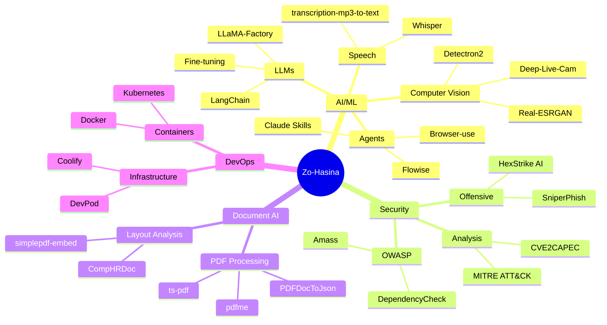

<!-- 
╔══════════════════════════════════════════════════════════════════════════════╗
║                                                                              ║
║   ███████╗ ██████╗       ██╗  ██╗ █████╗ ███████╗██╗███╗   ██╗ █████╗       ║
║   ╚══███╔╝██╔═══██╗      ██║  ██║██╔══██╗██╔════╝██║████╗  ██║██╔══██╗      ║
║     ███╔╝ ██║   ██║█████╗███████║███████║███████╗██║██╔██╗ ██║███████║      ║
║    ███╔╝  ██║   ██║╚════╝██╔══██║██╔══██║╚════██║██║██║╚██╗██║██╔══██║      ║
║   ███████╗╚██████╔╝      ██║  ██║██║  ██║███████║██║██║ ╚████║██║  ██║      ║
║   ╚══════╝ ╚═════╝       ╚═╝  ╚═╝╚═╝  ╚═╝╚══════╝╚═╝╚═╝  ╚═══╝╚═╝  ╚═╝      ║
║                                                                              ║
║                    R A S A T A V O H A R Y                                   ║
║                                                                              ║
╚══════════════════════════════════════════════════════════════════════════════╝
-->
<div align="center">

  <!-- Typing Animation -->
<a href="https://git.io/typing-svg">
  
</a>

<!-- Profile Stats Badges -->
<p align="center">
  
  
  
  
</p>

<!-- Social Badges -->
<p align="center">
  <a href="https://www.zonova.io">
    
  </a>
  <a href="https://resumify.app">
    
  </a>
  <a href="https://www.aquantic.io">
    
  </a>
  <a href="https://time-flow.eu">
    
  </a>
  <a href="https://matrixai.fr">
    
  </a>
</p>

<!-- Counter Badges -->
<p align="center">
  
  
  
  
</p>

</div>

---

## 🧬 About Me

```typescript
const zoHasina: TechFounder = {
  location: "🇫🇷 France",
  company: "Zonova SARL",
  role: "Founder & CEO",
  githubSince: "June 2009", // User #93783
  
  currentFocus: [
    "🤖 AI Agents & LLM Fine-tuning",
    "🔐 Cybersecurity Tools",
    "📄 Document AI & Processing",
    "🚀 Startup Products"
  ],
  
  expertise: {
    ai_ml: "LLMs, Computer Vision, Speech Recognition",
    security: "OWASP, Pentesting, Attack Surface Analysis",
    fullstack: "Node.js, TypeScript, Vue, React",
    devops: "Kubernetes, Docker, Cloud Architecture",
    hardware: "Arduino, NFC, IoT"
  },
  
  languages: [
    "JavaScript", "TypeScript", "Python", "Vue",
    "HTML/CSS", "Java", "C#", "Ruby", "Delphi"
  ],
  
  philosophy: `The less digitalized companies are 
    the ones which outcomes the most valuable 
    part of the market, when they follow the 
    path of Digitalisation and Innovation`
};
```
---

## 🏢 My Ventures

<div align="center">

<table>
<tr>
<td align="center" width="50%">

### 🌐 Zonova
**Innovation & Digitalisation**


Multi-technology mobile, web, desktop apps development. Project management, IT production, testing & validation.

[](https://www.zonova.io)
[](https://github.com/FR-Zonova)

</td>
<td align="center" width="50%">

### 📄 Resumify
**Show. Don't Tell.**


Smart portfolio platform with AI-powered resume generation. Partners: UTBM, Eucléa, ESTA Belfort.

[](https://resumify.app)
[](https://github.com/ResumifyApp)

</td>
</tr>
<tr>
<td align="center" width="50%">

### 💧 Aquantic
**Smart Work, Successful People**


Digital innovation, training (Docker, Kubernetes), personality testing for HR, management consulting.

[](https://www.aquantic.io)
[](https://github.com/AquanticTech)

</td>
<td align="center" width="50%">

### ⏱️ Time-Flow
**Master Your Time**


Time management and productivity solutions for modern teams and professionals.

[](https://www.time-flow.eu)

</td>
</tr>
<tr>
<td align="center" width="50%">

### 🧠 MatrixAI
**Intelligence Documentaire Sécurisée**


Secure document intelligence by ZONOVA Research. Private, on-premise AI to analyze, extract and reason over sensitive documents without leaking your data.

[](https://matrixai.fr)

</td>
<td align="center" width="50%">

<!-- Reserved for the next venture 🚀 -->

</td>
</tr>
</table>

</div>

---

## 🎓 Education & Credentials

<div align="center">

[](https://professional.mit.edu/)

**🏅 Certification in Artificial Intelligence Applied to Data Science** · *MIT Professional Education* · Mar – Jul 2026
Applied Artificial Intelligence & Data Sciences

</div>

<details>
<summary><b>📚 Full academic background & certifications</b></summary>

<br/>

| Year | Institution | Qualification |
|:----:|:------------|:--------------|
| 2026 | **MIT Professional Education** | Certification in AI Applied to Data Science — Applied AI & Data Sciences |
| 2005 | **UTBM** — Université de Technologie de Belfort-Montbéliard | DESS *Innov-acteur*, Innovation |
| 2001–2004 | **ENSISA** — École Nationale Supérieure d'Ingénieurs Sud Alsace | Diplôme d'Ingénieur, Ingénierie Logicielle |
| 2001–2004 | **ENSISA** | DEA — Diplôme d'Études Approfondies, Intelligence Artificielle |
| 1999–2001 | **Université de Haute-Alsace** — Mulhouse-Colmar | DUT GEII — Génie Électrique & Informatique Industrielle |

**Certifications:** `TOEIC — 850`

</details>

<details>
<summary><b>📝 Publications & Research</b></summary>

<br/>

- 📄 **Towards a Metrology of Exhaustiveness in Document Analysis** — A Systemic Framework for Layout Completeness Assessment
- 🧠 **State Space Models as CPU-Native Neural Network Architectures**
- ⚙️ **Cross-Platform Inference of 1.58-bit State Space Models** — ARM NEON vs x86 AVX-512 vs GPU CUDA
- 🏭 **Break-Through Effectiveness for the Maintenance and Dismantlement of Power Plants** — Application of Virtual Reality

</details>

---

## 💼 Professional Journey

<div align="center">

**20+ years** across AI/Data Science, software engineering, consulting, teaching and entrepreneurship.

</div>

<details>
<summary><b>🏢 Current roles</b></summary>

<br/>

| Role | Organization | Period |
|:-----|:-------------|:------:|
| 🤖 **Full & Transversal Stack AI Consultant Analyst** (DS, AI Model, EDA, LLMs) | Aquantic (Zonova SARL) | 2026 → now |
| 🧠 **Founder & Designer of MatrixAI.fr** — secure AI document intelligence (ZONOVA Research) | Aquantic (Zonova SARL) | 2024 → now |
| 🌐 **Consultant multidisciplinaire Tech & Innovation** — NodeJS expert, Team/Squad Lead, Low/NoCode, AI trainer, Google Workspace admin | Aquantic (Zonova SARL) | 2017 → now |
| 📈 **Fondateur & Architecte de Croissance Stratégique** — consulting, training & software distribution | Aquantic (Zonova SARL) | 2017 → now |
| 📄 **CEO & Investor** | Resumify | 2021 → now |
| 🎓 **Lecturer (Chargé de Cours/TD)** — Intelligence économique & data processing | UTBM | 2017 → now |

</details>

<details>
<summary><b>📜 Previous experience</b></summary>

<br/>

| Role | Organization | Period |
|:-----|:-------------|:------:|
| 🌍 Advisor of International Institution in Digital Technology (Blockchain, Crypto, Data Science) | — | 2017 – 2022 |
| 💡 Expert en innovation numérique & Système d'Information 2.0 | Puissance E | 2016 – 2021 |
| 🎓 Lecturer (Chargé de Cours/TD) | Université de Franche-Comté | 2017 – 2019 |
| 🤝 Member | APM — Association Progrès du Management | 2016 – 2018 |
| 🏛️ Président Directeur Général & Fondateur — portfolio clients, CA > 1 M€ | Digit-Prime | 2013 – 2017 |
| 🇨🇭 Co-founder & Partner | Digital-Solutions (ex Digit-Prime Switzerland) | 2016 – 2017 |
| 👔 Founder & CEO | Company in creation phasis | 2012 |
| ☕ Chef de projet & Expert Java — offshore project support | — | 2007 – 2009 |
| 🛠️ Chef de Projet & Technical Lead — offshore (up to 7 engineers) | — | 2005 – 2007 |
| 💻 Developer (new technologies) → Junior Developer | Software Editor | 2004 – 2005 |

</details>

---

## 🏗️ Selected Client Work & Realizations

<div align="center">

Highlights from the [Aquantic portfolio](https://portfolio-aquantic.saas-application.app/) — AI, Document Intelligence, training and product R&D.

</div>

<details>
<summary><b>🚀 Explore 14 realizations</b></summary>

<br/>

| Project | Description | Client / Domain |
|:--------|:------------|:----------------|
| 📑 **Comparaison Intelligente de Documents PDF (IA)** | AI-driven PDF comparison — saved the equivalent of **350 hours** of work | CAC 40 group — Nuclear/Energy |
| 🎓 **AI Training for 300+ people** | 6-part AI program (LLM, NLP, deep learning, deployment) — **85% satisfaction** | Groupama |
| 🗂️ **Document Classification & Analysis Platform** | Import, organize & extract information from PDFs and images via AI | Document AI |
| 💬 **ia-Jean — AI prompting app** | Early ChatGPT-era multi-prompting library across several LLMs | R&D — LLM |
| 🧭 **LeadPilot IA** | Chrome extension structuring B2B LinkedIn conversations & analyzing performance | B2B / AI Agent |
| 📄 **Resumify** | Data-driven platform turning a career profile into a shareable digital portfolio | HR / SaaS |
| 💊 **AI Model for Pharmacy** | PoC recommending para-pharmaceutical products for partner pharmacies | Pharma / Health |
| 📞 **Leexi integration — support call analysis** | NLP analysis of support calls to detect emotions & extract insights | Customer Support |
| 🎙️ **Speech Emotion Recognition** | Research recognizing joy, sadness, anger, surprise from voice datasets | R&D — Speech |
| 🌊 **AI strategy for fluidics startup** | Technical & budget guidance for AI predicting CFD physical quantities | CFD / Industry |
| 🏭 **Formation Formateurs 4.0** | Digital-tools & AI training for educators (foundry industry) | Training / Industry |
| 📦 **Logistics management suite** | Mobile app + REST web back-office for trade-fair logistics | SEMPEX (Basel MESSE) |
| 📊 **Calculation Desk** | Free office software to open/edit Excel & OpenOffice spreadsheets | Freeware / Tools |
| ⌨️ **PowerExpander** | Windows text-snippet library with instant hotkey access | Desktop / Tools |

</details>

---

## 🎯 Domain Expertise

<div align="center">

| Domain | Expertise | Key Projects |
|:------:|:----------|:-------------|
| 🤖 **AI & ML** | LLMs from scratch, Fine-tuning, Computer Vision, Speech Recognition, AI Agents | `transcription-mp3-to-text`, `whisper`, `detectron2`, `Flowise`, `LLaMA-Factory` |
| 🔐 **Cybersecurity** | OWASP Tools, Pentesting, CVE/MITRE Mapping, Attack Surface Analysis | `amass`, `hexstrike-ai`, `DependencyCheck`, `SniperPhish`, `CVE2CAPEC` |
| 📄 **Document AI** | PDF Analysis, Layout Detection, OCR Pipelines, Document Processing | `PDFDocToJson`, `pdfme`, `ts-pdf`, `simplepdf-embed`, `CompHRDoc` |
| 🌐 **Full-Stack** | Node.js, TypeScript, Vue, React, Chrome Extensions | `Iphone-Powered`, `http-server-basicauth-ssl`, `LibreChat`, `aquantic-front` |
| ☸️ **DevOps** | Kubernetes, Docker, Cloud Deployment, Dev Environments | `kubespray`, `devpod`, `coolify-cli`, `rudder`, `packer-templates` |
| 🔌 **Hardware/IoT** | Arduino, NFC, Smart Cards, Embedded Systems | `AFE4490_Oximeter`, `android-hce`, `cardpeek-emv`, `QRCoder` |

</div>

---

## 🛠️ Tech Arsenal

<div align="center">

### 💻 Languages
<p>
  
</p>

### 🤖 AI & Machine Learning
<p>
  
  
  
  
  
</p>

### 🔐 Security & OSINT
<p>
  
  
  
  
</p>

### ☁️ DevOps & Cloud
<p>
  
</p>

### 🗄️ Databases & Backend
<p>
  
</p>

### 🔧 Tools & Platforms
<p>
  
</p>

</div>

---

## 📊 GitHub Analytics

<div align="center">
  


</div>

<!-- Activity Graph -->
<div align="center">
  
</div>

<!-- 2025 Stats Card -->
<div align="center">
  
### 📈 2025 Activity
  
| Metric | Count |
|:------:|:-----:|
| 🔥 Total Contributions | **739** |
| 📝 Commits | **233** |
| 🔀 Pull Requests | **7** |
| 📦 Repository Contributions | **54** |

</div>

---
## 🏆 Achievements
[](https://github.com/rasata)    


---

## 🌟 Featured Projects

<div align="center">

<a href="https://github.com/rasata/Iphone-Powered">
  
</a>
<a href="https://github.com/rasata/http-server-basicauth-ssl">
  
</a>

</div>

### 🔬 Recent Original Projects

| Project | Description | Tech |
|:--------|:------------|:----:|
| 🎙️ [transcription-mp3-to-text](https://github.com/rasata/transcription-mp3-to-text) | Transcribe long mp3 files (12+ hours) using local AI | `Python` |
| 📄 [PDFDocToJson](https://github.com/rasata/PDFDocToJson) | PDF Document to JSON converter | `Document AI` |
| 🎄 [greeting-wall](https://github.com/rasata/greeting-wall) | Self-hosted service for end-of-year greetings | `TypeScript` |
| 🔧 [solve-issue-killer-network-service](https://github.com/rasata/solve-issue-killer-network-service) | Fix Killer Network Services issues on MSI laptops | `Utility` |
| 🎓 [formation-bigquery](https://github.com/rasata/formation-bigquery) | BigQuery training materials | `Data Engineering` |

---

## 🔭 Currently Exploring

<div align="center">

Based on my recent activity and starred projects:

| Interest | Projects | Why |
|:---------|:---------|:----|
| 🤖 **AI Assistants** | `openclaw/openclaw` ⭐118k | Personal AI that truly understands context |
| 👁️ **Computer Vision** | `detectron2` ⭐34k | Object detection & segmentation at scale |
| 🐚 **AI Shell Tools** | `ShellOracle` | Intelligent command generation |
| 🎭 **Claude Skills** | `awesome-claude-skills` ⭐28k | Extending AI capabilities |
| 📡 **WebRTC** | `coturn` ⭐13k | Real-time communication infrastructure |

</div>

---

## 🧠 AI & Security Stack

<div align="center">



</div>

---

## 💡 Philosophy

<div align="center">

```
╔═══════════════════════════════════════════════════════════════════════════════╗
║                                                                               ║
║   "The less digitalized companies are the ones which outcomes the most        ║
║    valuable part of the market, when they follow the path of                  ║
║    Digitalisation and Innovation"                                             ║
║                                                                               ║
║                                              — Zo-Hasina Rasatavohary         ║
║                                                                               ║
╚═══════════════════════════════════════════════════════════════════════════════╝
```

</div>

---

## 🤝 Let's Connect & Collaborate

<div align="center">

<p>
  <a href="https://www.linkedin.com/company/zonova">
    
  </a>
  <a href="mailto:contact@zonova.io">
    
  </a>
  <a href="https://github.com/rasata">
    
  </a>
  <a href="https://gist.github.com/rasata">
    
  </a>
</p>

### 💼 Open for

<p>
  
  
  
  
</p>


</div>

---

## 📅 GitHub Journey Timeline

<div align="center">

```
2009 ─────────────────────────────────────────────────────────────────── 2025
  │                                                                        │
  ├─ 🎂 Joined GitHub (June 9, 2009)                                       │
  │   User #93783 - Early Adopter                                          │
  │                                                                        │
  ├─ 📱 Iphone-Powered (2014)                                              │
  │   First popular project - 50+ ⭐                                       │
  │                                                                        │
  ├─ 🏢 Founded Zonova                                                     │
  │   Innovation & Digitalisation                                          │
  │                                                                        │
  ├─ 💧 Launched Aquantic                                                  │
  │   Training & Consulting                                                │
  │                                                                        │
  ├─ 📄 Building Resumify (2024-Now)                                       │
  │   AI-powered portfolio platform                                        │
  │                                                                        │
  ├─ 🧠 Launched MatrixAI (2024)                                           │
  │   Secure Document Intelligence — ZONOVA Research                       │
  │                                                                        │
  ├─ 🎓 MIT Professional Education (2026)                                   │
  │   AI Applied to Data Science — Certified                               │
  │                                                                        │
  └─ 🚀 2025: 739 contributions & counting!                                │
      233 commits | 7 PRs | 54 repo contributions                          │
```

</div>

---

<!-- Footer -->
<div align="center">
  


<p>
  
  
  
  
</p>

**✨ "Innovation distinguishes between a leader and a follower" — Steve Jobs ✨**

<sub>⭐ Star my repos if you find them useful! | 🤝 Let's build something amazing together | 💼 Open for opportunities</sub>

---


**@rasata** · Serial Entrepreneur · AI & Security Expert · 16+ Years on GitHub

</div>
